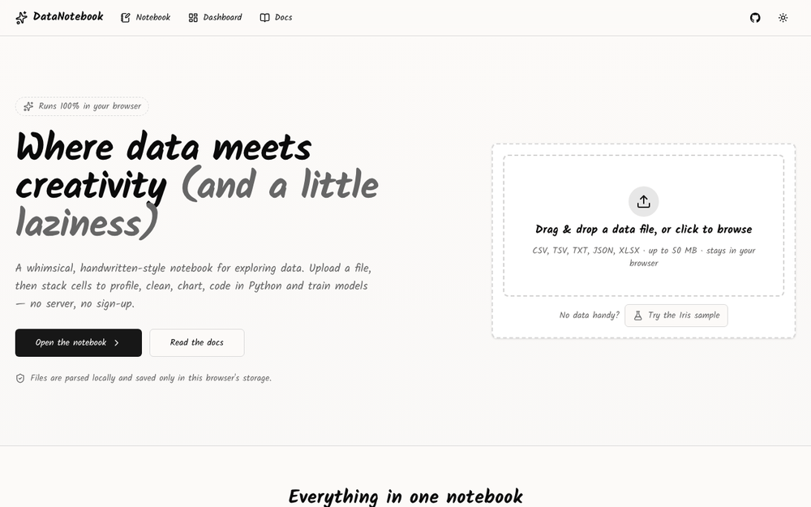
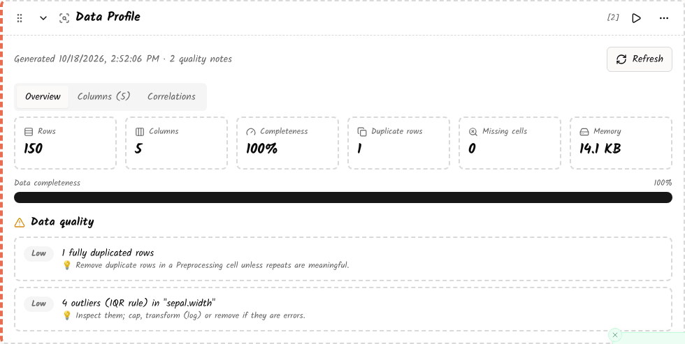
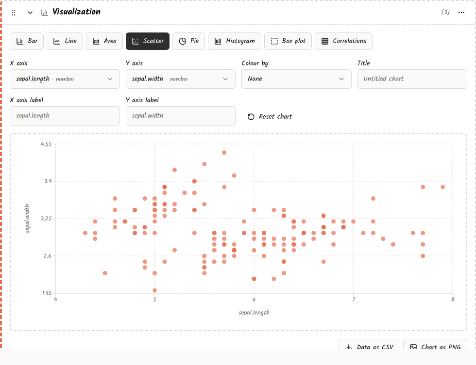
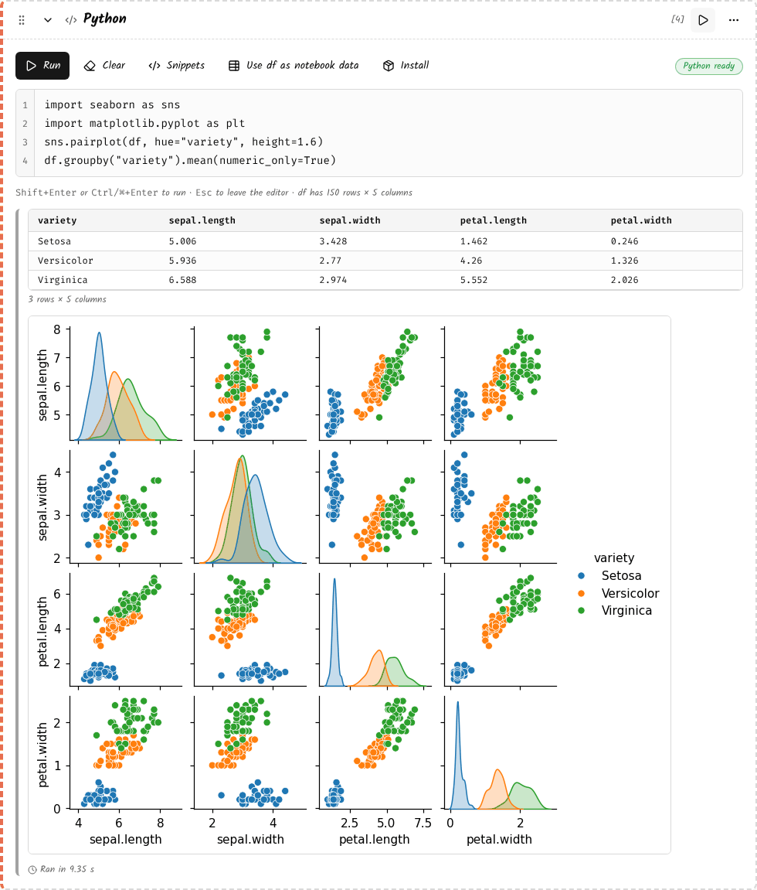
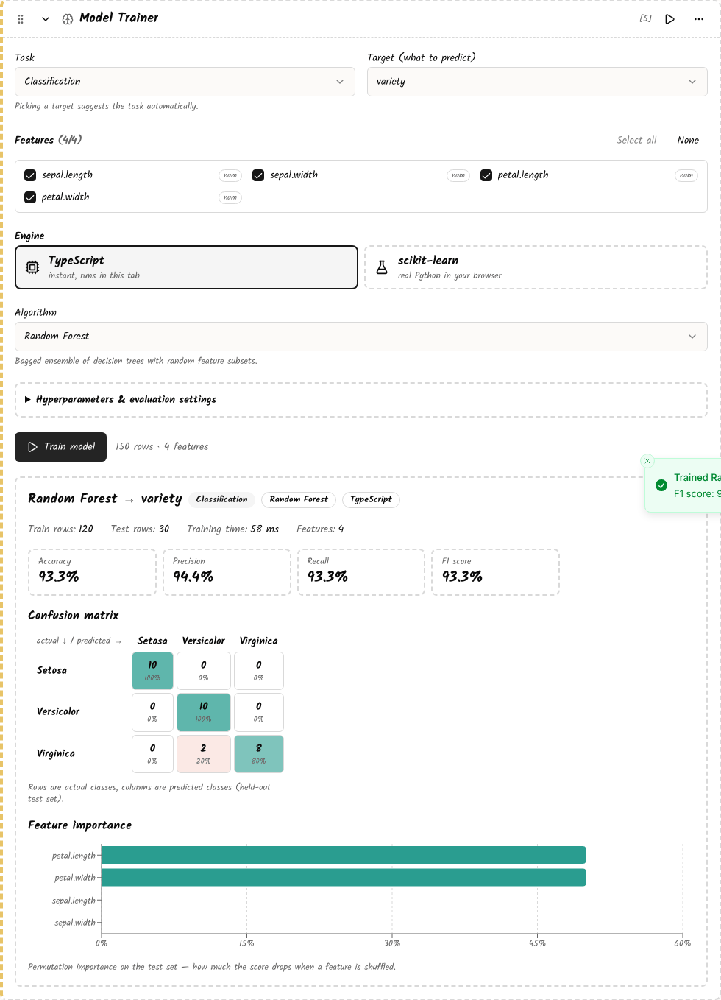
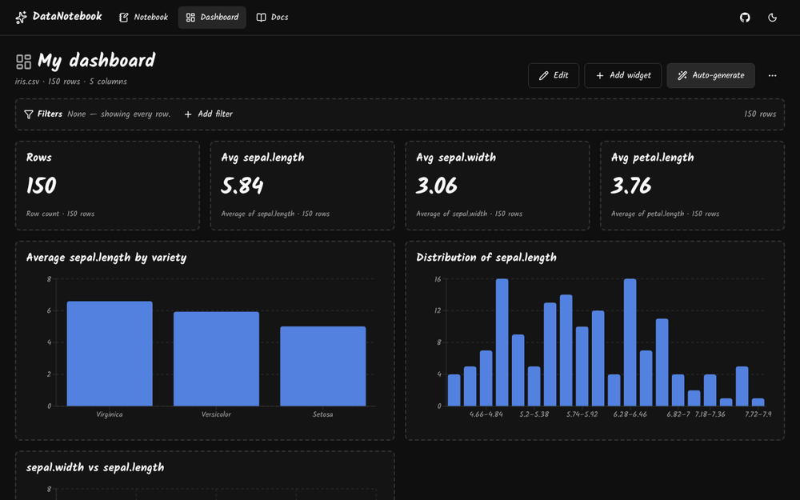
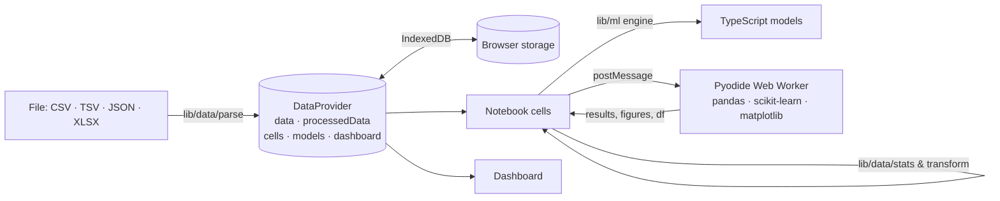

<div align="center">

# ✏️ DataNotebook

_A whimsical, handwritten-style data analysis notebook that runs entirely in your browser._

### _“Where data meets creativity (and a little laziness)”_

[](https://github.com/Kedhareswer/Data_Science_Platform/actions/workflows/ci.yml)
[](https://nextjs.org/)
[](https://react.dev/)
[](https://www.typescriptlang.org/)
[](https://tailwindcss.com/)
[](https://pyodide.org/)
[](./LICENSE)



</div>

Drop in a CSV, TSV, JSON or Excel file and stack **cells** to profile it, clean it, chart it, write real **Python**
(pandas, scikit-learn, matplotlib, seaborn) and train **machine-learning models** — then turn the results into a
**dashboard**. There is no backend: parsing, statistics, Python and model training all happen on your device, and
your workspace is saved in your browser.

## ✨ Features

| Cell / page           | What it does                                                                                                                         |
| --------------------- | ------------------------------------------------------------------------------------------------------------------------------------ |
| 📋 **Data Table**     | Search, typed sorting, pagination, CSV/JSON export of the current view                                                               |
| 🔍 **Data Profile**   | Mean, median, quartiles, std, skewness, kurtosis, top values, IQR outliers, duplicates, completeness, quality warnings, correlations |
| 🕳️ **Missing Data**   | Missing-value counts, missingness matrix, co-missing pairs and one-click fixes                                                       |
| 📈 **Visualization**  | Bar, line, area, scatter, pie, histogram, box plot and correlation heatmap with aggregation, grouping and PNG/CSV export             |
| 🪄 **Preprocessing**  | Replayable pipeline (filter, impute, de-duplicate, drop/rename/cast, scale, encode, remove outliers), exportable as pandas code      |
| 📝 **Notes**          | GitHub-flavoured Markdown                                                                                                            |
| 🐍 **Python**         | Pyodide in a Web Worker; your data is `df`; figures, tables, live output, Stop, auto-install of pure-Python packages                 |
| 🧠 **Model Trainer**  | TypeScript engine or real scikit-learn; held-out metrics, confusion matrix, permutation feature importance                           |
| ✨ **AutoML**         | Trains every applicable algorithm on the same split and ranks them                                                                   |
| 🎯 **Predictor**      | Single-row or batch predictions with class probabilities; CSV download; model JSON import/export                                     |
| 🔬 **Model Insights** | Model comparison, ROC & PR curves, residuals, cluster sizes — all from real test-set predictions                                     |
| 📊 **Dashboard**      | Auto-generated, editable dashboard of metrics, charts, tables and notes with global filters                                          |

Plus: drag-and-drop cell reordering, **Run all**, notebook export/import (`.dnb.json`, optionally with data), automatic
persistence to IndexedDB, light/dark/system themes and keyboard-accessible UI.

<table>
  <tr>
    <td></td>
    <td></td>
  </tr>
  <tr>
    <td></td>
    <td></td>
  </tr>
</table>



## 🚀 Quick start

```bash
git clone https://github.com/Kedhareswer/Data_Science_Platform.git
cd Data_Science_Platform
npm install        # Node.js >= 20.9
npm run dev        # http://localhost:3000
```

Open the notebook and click **Try the Iris sample**, or drop in your own file.

### Scripts

| Command                | Description                                                      |
| ---------------------- | ---------------------------------------------------------------- |
| `npm run dev`          | Development server (Turbopack)                                   |
| `npm run build`        | Production build — type errors and lint failures are not ignored |
| `npm start`            | Serve the production build                                       |
| `npm run lint`         | ESLint (flat config, Next.js + React Compiler rules)             |
| `npm run typecheck`    | `tsc --noEmit`                                                   |
| `npm test`             | Vitest unit tests for the data, ML and dashboard libraries       |
| `npm run check`        | lint + typecheck + test                                          |
| `npm run check:python` | Runs the in-browser Python helpers under CPython + scikit-learn  |
| `npm run format`       | Prettier                                                         |

### Configuration

Everything works with zero configuration. Optionally copy `.env.example` to `.env.local`:

| Variable                        | Purpose                                                                                  |
| ------------------------------- | ---------------------------------------------------------------------------------------- |
| `NEXT_PUBLIC_PYODIDE_INDEX_URL` | Load Pyodide from your own host instead of jsDelivr (folder with `pyodide.mjs` + wheels) |

Deploys as a fully static site on Vercel (Web Analytics is enabled automatically there) or any Node host.

## 🏗️ How it works



- **`lib/data`** — pure, tested data layer: parsing (PapaParse, read-excel-file), whole-column type inference,
  pandas-compatible statistics and profiling, serializable preprocessing steps.
- **`lib/ml`** — pure, tested ML engine: ridge regression, softmax logistic regression, k-NN, CART decision trees,
  random forests, Gaussian naive Bayes and k-means, with a seeded stratified split, an impute/scale/one-hot pipeline,
  metrics, permutation importance and AutoML. Models are plain JSON.
- **`lib/python`** — Pyodide runtime in a Web Worker. User code and data are never interpolated into Python source;
  Stop terminates the worker.
- **`components/cells`** — one component per cell type, each persisting its state with `useCellContent`.

See [`CLAUDE.md`](./CLAUDE.md) for the full architecture guide and conventions.

### Tech stack

Next.js 16 (App Router, Turbopack) · React 19 · TypeScript 6 · Tailwind CSS 4 · Radix UI primitives · Recharts 3 ·
Pyodide · PapaParse · read-excel-file · react-markdown · Sonner · Vitest · ESLint 9 · Prettier · GitHub Actions.
Typography: Kalam (handwritten) and Fira Code via `next/font`.

## 🔒 Privacy

Your files never leave your browser — there are no API routes. The Python runtime is downloaded from a CDN the first
time you use it (no data is sent), and pure-Python packages you import are fetched from PyPI. See the in-app
[privacy page](app/privacy/page.tsx).

### Security

- No API routes or server-side execution; `npm audit --omit=dev` reports **0 vulnerabilities** in runtime dependencies.
- Strict security headers (CSP, `X-Frame-Options: DENY`, `nosniff`, `Referrer-Policy`, `Permissions-Policy`, COOP).
  The CSP only lets the app (and its Python worker) connect to its own origin, the Pyodide CDN and PyPI, so code in an
  imported notebook cannot send your data to other servers.
- Markdown is rendered without raw HTML; CSV exports neutralise spreadsheet formulas; user code and data are never
  interpolated into Python source.
- Dev tooling: `npm audit` still lists the `braces` advisory pulled in by `eslint-config-next`. It only affects local
  linting and has no patched release yet.

## 🗺️ What changed in v2

v2 is a ground-up modernization of the original v0.dev prototype:

- **Security** — removed the server endpoint that executed arbitrary Python and `pip install` on the host (remote code
  execution); Python now runs sandboxed in the browser.
- **Honesty** — removed simulated features (random ML metrics/predictions, timer-driven “Run all” and progress bars);
  every number shown is computed.
- **Correctness** — proper CSV parsing, Excel support, whole-column type inference, fixed statistics (median,
  correlations, duplicates, completeness) and ML bugs; unit tests for the data, ML and dashboard libraries plus a CPython check of the Python helpers.
- **Platform** — Next.js 16, React 19, TypeScript 6, Tailwind 4, pinned dependencies, strict builds, CI.
- **Product** — persistent workspace, notebook import/export, real Run all, a working dashboard, scikit-learn engine,
  AutoML, rebuilt navigation and accessibility fixes.

## 🤝 Contributing

Contributions are welcome — read [`CONTRIBUTING.md`](./CONTRIBUTING.md) and run `npm run check` before opening a PR.

## 📄 License

[MIT](./LICENSE) © Kedhareswer
